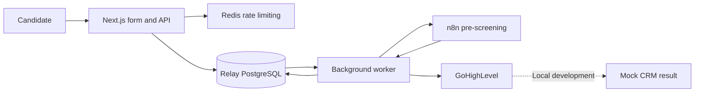

# Relay Solicitudes

A candidate intake and pre-screening prototype built to capture applications reliably and process them through an asynchronous workflow.

> **Status:** Local prototype. The development environment uses a mock CRM integration. This repository does not represent a production deployment.  
> **Live demo:** https://relay-solicitudes-web-source.vercel.app 

## Project overview

Relay Solicitudes provides a bilingual application form and a backend workflow for receiving candidate information, validating submissions, and preparing them for review.

When a candidate submits the form, the API stores the application and a processing job in PostgreSQL before returning success. A background worker processes the job, requests a pre-screening result from n8n, stores that result, and attempts CRM synchronization. The durable queue supports retries when a downstream service is unavailable.

https://github.com/user-attachments/assets/dcdc792e-abf7-4e18-b938-6d376bec97fb

## How it works



1. The candidate submits an application in English or Spanish.
2. The API validates the submission and saves it with a processing job.
3. The worker sends the application to the n8n workflow for pre-screening.
4. The worker stores the result and processes CRM synchronization.
5. Failed jobs can be retried or reviewed.

## Main components

- **Web application:** Next.js form and API routes for application intake.
- **Relay database:** PostgreSQL stores applications, job state, and processing history.
- **Worker:** Processes queued jobs, retries failures, and coordinates external services.
- **n8n workflow:** Applies the pre-screening rules using a read-only database view.
- **Redis:** Provides shared rate limiting for the web application.
- **GoHighLevel integration:** Implemented behind the worker; local development uses mock mode.

## Repository structure

| Path | Purpose |
| --- | --- |
| `web/` | Next.js application, API, worker, database migrations, and tests. |
| `web/src/config/prequalification.json` | Server-side pre-screening rules supplied to the workflow. |
| `web/scripts/` | Migration, worker, job-management, and workflow-generation scripts. |
| `n8n/workflows/relay-classify.json` | Importable n8n classification workflow. |
| `n8n/score.js` | Source for the workflow’s scoring logic. |
| `n8n/future/` | Scripts reserved for a future voice workflow; not active in the current flow. |
| `docs/` | Architecture, local setup, operation, demo, validation, and project handoff documentation. |
| `docker-compose.yml` | Base services for the application stack. |
| `docker-compose.dev.yml` | Local development settings, including mock CRM behavior and local port mappings. |
| `docker-compose.campaign.yml` | Configuration for the campaign deployment profile. |
| `Caddyfile` | Reverse-proxy configuration used by the production profile. |
| `.env.example` | Template for non-local environment configuration. |
| `.env.dev.example` | Local-only development configuration template. |

## Run locally

Requirements: Docker Desktop and Docker Compose v2.

From the repository root in Git Bash:

```bash
if [ ! -f .env.dev ]; then
  cp .env.dev.example .env.dev
fi

docker compose --env-file .env.dev \
  -f docker-compose.yml \
  -f docker-compose.dev.yml \
  up -d --build
```

Open the form at [http://localhost:3000/warehouse-associate?lang=es](http://localhost:3000/warehouse-associate?lang=es). The local n8n editor is at [http://localhost:5679](http://localhost:5679).

For first-time setup, import `n8n/workflows/relay-classify.json`, configure its local credentials, and activate the workflow. See the [documentation index](docs/README.md) for the complete setup and demo instructions.

To stop the services while retaining local data, run the same Compose command with `down`. Do not add `-v` if you want to keep the database and n8n volumes.

## Documentation

Start with [`docs/README.md`](docs/README.md), which links to:

- [Architecture](docs/arquitectura.md)
- [Local setup and handoff](docs/entrega-al-equipo.md)
- [Demo guide](docs/GUIA-DEMO.md)
- [Web application and worker](docs/web-worker.md)
- [n8n workflow](docs/n8n-workflow.md)
- [Testing and deployment](docs/pruebas-y-despliegue.md)
- [Campaign capacity](docs/campanas-y-capacidad.md)
- [Validation record](docs/VALIDACION.md)
- [Future phase proposal](docs/propuesta-ghl-n8n-retell.md)

## Scope and limitations

- The local CRM mode is simulated and does not create real GoHighLevel contacts.
- The included pre-screening criteria are examples and require business approval before real use.
- Production deployment, live CRM credentials, voice calls, and recruiter notifications are outside the current prototype.
- Use fictional candidate data for local demonstrations.
- Keep real credentials in local environment files or deployment settings; never commit them to the repository.
